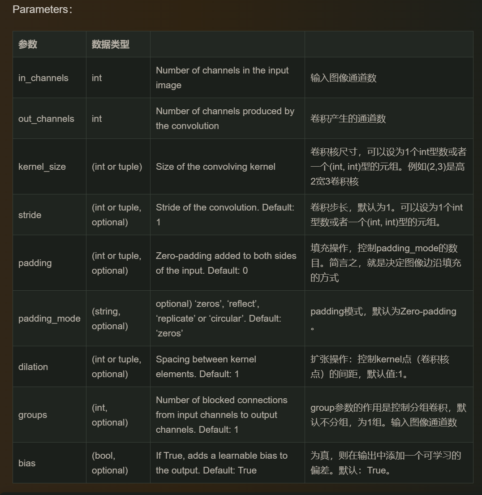
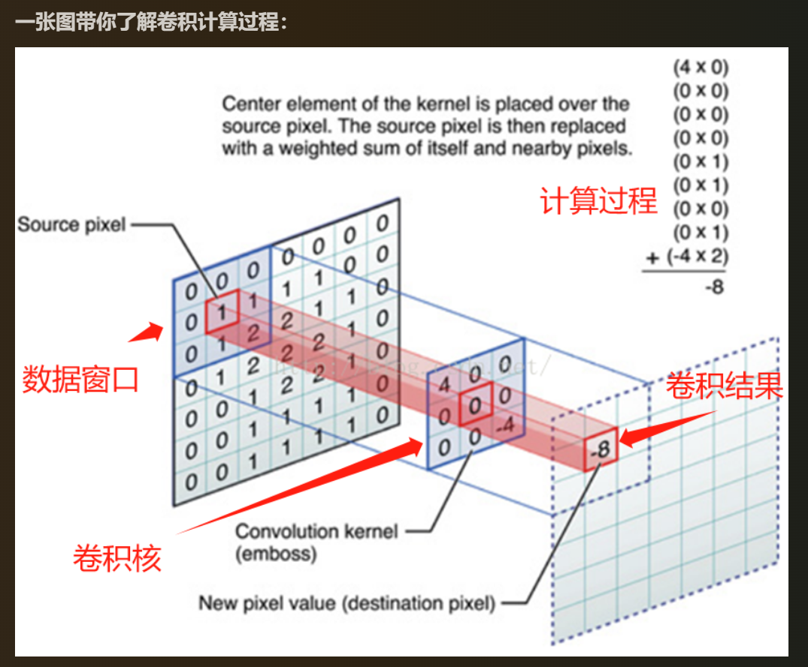

conv2d（二维卷积）的参数（parameters）：

原图和卷积核的每个数相乘后再相加得卷积后的数：

训练过程：
optimizer.zero_grad()             # 1. 清空旧梯度
outputs = net(images)             # 2. 前向传播
loss = criterion(outputs, labels) # 3. 计算损失
loss.backward()                   # 4. 反向传播，算梯度
optimizer.step()                  # 5. 用梯度更新参数
